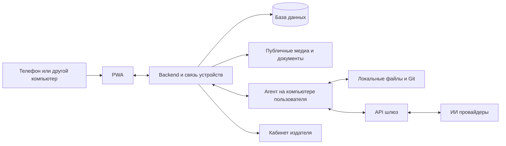

# про.стим интерфейс и первый релиз

Основа интерфейса объединяет визуальную ленту, раздел Steam и ИИ-мир. Веб-приложение предоставляет выбор GitHub, Google Drive, Яндекс Диска или папки текущего устройства. Подключение реальных модельных запросов и облачной авторизации следует после проверки интерфейса и настройки приложений провайдеров.

## Навигация

Основные разделы приложения — «Лента», «Steam» и «ИИ-мир». На телефоне они доступны из нижней панели, на компьютере — из верхнего меню. Профиль открывается из шапки. В каждом основном разделе имеется собственная навигация по подразделам.

| Адрес | Содержание |
| --- | --- |
| `/feed` | Лента проектов |
| `/projects/:slug` | Подробная страница проекта |
| `/ai` | Рабочее пространство с файлами и помощником |
| `/ai/connections` | GitHub, облачные источники и локальная папка |
| `/ai/guide` | Объяснение способов работы с проектом |
| `/steam` | Вводная страница издательского направления |
| `/steam/publishing` | Порядок публикации и расчётов |
| `/steam/documents` | Инструкции и документы по Steam |
| `/steam/discussions` | Тематические обсуждения Steam |
| `/account` | Профиль, проекты и настройки |

Открытая страница проекта имеет собственный адрес для отправки ссылки. Возврат в ленту восстанавливает выбранный проект, позицию прокрутки и слайд карточки. Прямая ссылка работает независимо от того, посещал ли пользователь ленту ранее.

## Экран удалённой работы

Пользователь выбирает источник проекта. Браузерный режим показывает дерево файлов, редактор, способ оплаты и помощника. При подключении удалённого компьютера дополнительно отображаются состояние устройства, вывод команд, diff и действия Git в пределах выбранных прав.

На телефоне сообщения, изменения и вывод команд переключаются вкладками. На компьютере они могут отображаться рядом. При недоступности рабочего устройства интерфейс предлагает восстановить подключение. Историю сессии возвращает локальный агент. [Архитектура удалённой работы](remote-work.md)

## Карточка проекта

Первый экран содержит трейлер или обложку, название, одну короткую фразу о пользе и имя автора. Кнопки позволяют поддержать проект, сохранить его, открыть комментарии, поделиться ссылкой и открыть подробности.

Карточка может включать несколько слайдов. Автор выбирает порядок скриншотов, коротких пояснений и видео. Лента должна одинаково работать с вертикальными и горизонтальными материалами. Обложка заполняет свободное пространство при сохранении исходных пропорций медиа.

| Действие | Результат |
| --- | --- |
| Свайп вверх или вниз | Следующий или предыдущий проект |
| Свайп влево или вправо | Следующий или предыдущий слайд проекта |
| Нажатие «Подробнее» или области карточки вне кнопок | Страница проекта |
| Нажатие стрелки вверх | Добавление или снятие поддержки |
| Нажатие «Сохранить» | Добавление или удаление из личной подборки |
| Нажатие комментариев | Обсуждение выбранной публикации |
| Закрытие подробностей или системная кнопка назад | Возврат к сохранённому месту ленты |

Горизонтальный жест переключает слайд после определения направления. Обычное нажатие сохраняет отдельное поведение. На первом и последнем слайдах карточка остаётся в пределах проекта. На компьютере используются прокрутка и видимые кнопки переключения. Для клавиатуры предоставляются доступные элементы управления.

Видео запускается у видимой карточки без звука и останавливается при переходе. Звук включается пользователем. Настройки экономии трафика и ограничения анимации отключают автоматическое воспроизведение. При ошибке загрузки отображаются обложка и кнопка повторной попытки.

## Страница проекта

Открытый пост — небольшая страница в духе магазина Steam или Epic Games, но для любых проектов: игр, приложений, инструментов, ботов, сайтов и всего, что сделано вайбкодингом. Код страницы и проверки её содержимого общие для браузера и сервера: [`site/src/page.js`](../site/src/page.js).

### Что заполняет автор

Публикация разбита на три коротких шага. Обязательны только название и короткое описание.

| Шаг | Поля |
| --- | --- |
| Основное | Фото, GIF и видео (до 8 файлов, первое — обложка), название, короткое описание, раздел |
| Детали | Стадия, платформы, цена, кого ищет автор, отметка «Сделано с помощью ИИ», чем сделано, до 6 ссылок, трейлер, теги |
| Страница | Цвет фона, цвет акцента, шрифт и блоки страницы |

Ссылки распознаются по адресу: Steam, Epic Games, itch.io, GOG, GitHub, GitLab, App Store, Google Play, RuStore, Telegram, Discord, YouTube, VK и Figma получают свою иконку и подпись, остальные показываются как сайт. Первая ссылка становится главной кнопкой страницы, например «В Steam».

Если файлов нет, обложкой в ленте становится название проекта шрифтом и на цвете страницы. Готовых картинок-шаблонов нет.

### Редактор страницы

Страница собирается из блоков: заголовок, текст, фото или GIF, видео, список, цитата, кнопка-ссылка и линия. Блоки можно переставлять и удалять, всего до 30. У текстовых блоков есть размер (S, M, L, XL), насыщенность, выравнивание, свой шрифт и цвет. В тексте работают `**жирный**`, `_курсив_` и ссылки вида `[текст](https://…)`.

Шрифты: обычный (Inter), акцентный (Unbounded), книжный (Playfair Display), код (JetBrains Mono), мягкий (Comfortaa), от руки (Caveat) и пиксельный (Press Start 2P). Все поддерживают кириллицу и подгружаются с Google Fonts, только когда нужны.

Автор не пишет HTML. Страница хранится как список блоков с разрешёнными стилями, а сервер отбрасывает всё остальное: неизвестные блоки и шрифты, цвета не в формате `#rrggbb`, ссылки не на `http` и `https`, файлы, которые загрузил не автор. Поэтому чужая страница не может запустить скрипт или подменить интерфейс.

Цвет текста и кнопок подбирается по контрасту с фоном: на светлом фоне текст тёмный, на тёмном — светлый. Остальной интерфейс поста (факты, комментарии, кнопки) перекрашивается под фон страницы.

### Как пост открывается

На телефоне пост открывается шторкой на 70% экрана. Когда его прокручивают, он разворачивается на всю высоту. Свайп вниз от начала страницы сначала возвращает шторку на 70%, длинный или быстрый свайп закрывает её. На компьютере пост открывается широким окном: слева галерея, справа название, кнопки, факты и теги, ниже страница автора и комментарии.

Автор открывает свой пост и нажимает «Редактировать»: откроются те же три шага с заполненными полями. После сохранения пост сразу показывается с изменениями.

## Комментарии и обсуждения

Под карточкой проекта доступны комментарии, ответы автора и ссылки на обновления. Для первого релиза предлагается один уровень ответов. Пользователь может редактировать свой комментарий, удалить его и пожаловаться на чужую публикацию. Открытие и закрытие комментариев сохраняет место ленты.

В разделе паблишинга пользователь может создать тему, выбрать категорию Steam, задать вопрос и отвечать другим участникам. Первые категории могут включать подготовку страницы, сборки, релизы и обновления. Каждая тема имеет собственную ссылку. Рядом размещаются инструкции и документы по соответствующим вопросам.

Издатель и модераторы могут закреплять инструкции, управлять категориями и рассматривать жалобы. Переписка по договору и финансовые документы доступны в кабинете соответствующей заявки. Автор проекта может указать ссылку на своё Telegram-сообщество. Для сообщества «про.стим» ссылка на Telegram выбирается при запуске.

## Выдача и рекомендации

Лента показывает один проект на экран и подбирает порядок под человека. Подбор складывается из двух оценок: насколько пост интересен всем и насколько он подходит этому зрителю. Код подбора общий для браузера и сервера: [`site/src/recommend.js`](../site/src/recommend.js).

### Интерес поста

Интерес поста — совокупность поддержки, сохранений, комментариев, репостов и удержания аудитории. Удержание считается по времени на экране: просмотр дольше ожидаемого засчитывается как досмотр, уход быстрее чем за 1,2 секунды — как пролистывание. Ожидаемое время — несколько секунд на слайд или длина видео.

| Составляющая | Вес | Что учитывает |
| --- | --- | --- |
| Удержание | 35% | Доля досмотров и просмотров дольше пары секунд |
| Без пролистываний | 20% | Доля быстрых пролистываний и «Не интересно» |
| Популярность | 30% | Поддержка, сохранения ×2, комментарии ×2, репосты ×3, в логарифмической шкале |
| Действия | 15% | Открытия подробностей, репосты и повторы видео на один показ |

Пока показов мало, удержание и пролистывания сглаживаются нейтральным значением, поэтому новый пост с тремя просмотрами не получает ни слишком высокую, ни слишком низкую оценку. В карточке проекта показывается шкала «Интерес», поддержка, сохранения, процент досмотров и число показов.

### Интересы зрителя

Каждое действие сдвигает веса категорий, тегов, авторов и типа медиа поста. Сильнее всего влияют подписка, сохранение, репост и комментарий, затем поддержка, открытие подробностей, долгий просмотр, листание слайдов и повтор видео. Быстрое пролистывание и «Не интересно» уменьшают веса. Старые сигналы теряют половину силы за 10 дней, поэтому интересы меняются вместе с человеком.

В начале у зрителя нет истории, и порядок определяют интерес поста и свежесть. По мере накопления сигналов личные интересы получают всё больший вес. В профиле видно, что лента узнала: главные интересы и уровень уверенности. Их можно сбросить.

### Маленькая база контента

Пока проектов мало, лента никогда не убирает пост из выдачи, а только меняет порядок:

- Непросмотренные посты идут первыми.
- Только что просмотренный пост уходит в конец и возвращается по мере того, как проходит время.
- Один автор не стоит два раза подряд, если есть выбор.
- После последнего поста начинается следующий круг с лучшим из просмотренного, до четырёх кругов. Между первым и вторым кругом показывается карточка «Новое закончилось» с обновлением и публикацией.
- Если в выбранной категории пусто, показываются проекты из других разделов.

Каждый пост на карточке подписан причиной показа: «Новое», «Для тебя», «Подписки», «Популярное», «Снова» или «Открытие».

### Обновление ленты

Ленту обновляет свайп вниз в её начале, как в TikTok и Reels, повторное нажатие на «Главную» или «Ленту» и кнопка обновления. При обновлении сервер присылает новые проекты, а порядок пересчитывается с учётом новых сигналов. До обновления порядок не меняется, чтобы пост не прыгал под пальцем.

Открытый пост закрывается крестиком, свайпом вниз от начала страницы (на телефоне сначала до 70% экрана), на компьютере ещё и прокруткой трекпада вверх в её начале, клавишей Esc или кликом мимо окна. Если в поле комментария есть неотправленный текст, свайп не закрывает пост, чтобы текст не потерялся.

### Хранение сигналов

Браузер отправляет на сервер пакеты событий: показ с временем на экране, открытие, репост, повтор видео, «Не интересно» и действия с постом. Сервер обновляет общие счётчики поста для всех и, если зритель вошёл, его интересы в аккаунте. У гостя интересы хранятся только в браузере. Свои посты не увеличивают собственные счётчики.

Сохранение проекта отделяется от поддержки и остаётся личным действием. Каждый пользователь может поддержать проект один раз и затем снять реакцию. Модератор рассматривает жалобы на публичный контент.

## Основные данные

| Сущность | Назначение |
| --- | --- |
| Пользователь | Профиль и настройки доступа |
| Проект | Автор, описание, категория и состояние публикации |
| Участник проекта | Роль пользователя внутри выбранного проекта |
| Устройство | Владелец, привязка и состояние подключения |
| Подключённая рабочая папка | Устройство и локальное соответствие проекта |
| Рабочая сессия | Участники, права и идентификатор локальной истории |
| Медиа проекта | Тип, порядок, файл, обложка и подпись |
| Реакция | Поддержка проекта с уникальной парой пользователя и проекта |
| Сохранение | Личная подборка пользователя |
| Комментарий | Автор, публикация проекта и родительский ответ |
| Тема Steam | Категория, автор, состояние и ответы |
| Заявка издателю | Игра, материалы, обсуждение и этап рассмотрения |
| ИИ задача | Идентификатор, устройство, модель, статус и ссылка на локальную историю |
| Запись использования | Измеренный расход и стоимость операции |
| Расчёт по игре | Отчётный период, доход, удержания и выплата |

Финансовые записи имеют отдельные права доступа. Изменение публичной карточки сохраняет ссылки на существующие заявки и задачи.

## Предлагаемая архитектура

Адаптивный frontend работает как PWA. Backend отвечает за аккаунты, устройства, сессии, публичные проекты, обсуждения, заявки и учёт использования. Объектное хранилище содержит опубликованные медиа и документы кабинета. Локальный агент хранит рабочие файлы и историю, выполняет инструменты и обращается к модели через выбранный маршрут.

Технологии и хостинг выбираются при начале реализации. Предлагается один backend с модулями по направлениям сервиса и устанавливаемый агент устройства. Для подготовки публичных медиа могут использоваться отдельные фоновые исполнители. Изменяющие операции и учёт расходов поддерживают повтор доставки без дублирования результата.

## Этапы разработки

1. **Основа интерфейса.** Собрать адаптивные разделы «Лента», «Steam» и «ИИ-мир», взаимодействия с карточками и браузерный редактор.
2. **Источники и ИИ.** Настроить OAuth-приложения, доступ к выбранным облачным файлам, модельный API, лимиты и варианты оплаты.
3. **Пользовательские данные.** Добавить аккаунты и серверное хранение публичных карточек, комментариев и тем.
4. **Паблишинг.** Подключить отправку заявок, кабинет издателя и этапы работы. Провести первую игру через согласованный процесс публикации и расчётов.
5. **Удалённый доступ.** Добавить локальный агент для команд на другом компьютере, оценить полный рабочий стол, внешние MCP-инструменты и облачные исполнительные среды.

Сроки оцениваются после выбора команды, технологий и объёма первого пилота. Численные цели аудитории и тарифы уточняются по фактическим данным.

## Критерии технического пилота

- Пользователь подключает компьютер с проектом и запускает задачу из браузера другого компьютера.
- Агент сохраняет исходники и историю локально, а сервер хранит предусмотренные метаданные и расходы.
- Интерфейс показывает место выполнения, состояние устройства и способ оплаты ИИ.
- Потеря связи и повтор команды восстанавливают известное состояние без повторного применения изменений.
- Изменённый пользователем файл учитывается при применении diff, а конфликт отображается в сессии.

## Критерии пользовательского релиза

- Пользователь открывает публичный проект по прямой ссылке с телефона и компьютера.
- Автор создаёт черновик, загружает материалы, меняет их порядок и публикует проект.
- Вертикальная прокрутка и горизонтальные слайды работают независимо, включая управление клавиатурой.
- Возврат из подробностей восстанавливает место ленты и выбранный слайд.
- Пользователь комментирует проект, отвечает в теме Steam и возвращается к исходному экрану.
- Повторное нажатие и повтор сетевого запроса сохраняют корректную единственную реакцию.
- Частные материалы доступны только участникам с соответствующими правами.
- Заявка издателю сохраняется и появляется в кабинете автора и издателя.
- Ошибка загрузки, пустая выдача и потеря соединения имеют понятные действия восстановления.
- При подключённом ИИ пользователь видит расход, может ограничить бюджет и получает результат либо понятную ошибку задачи.
