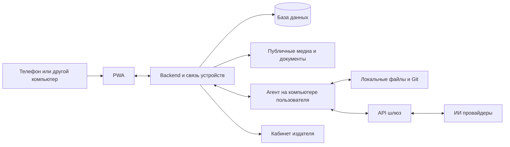

# про.стим интерфейс и первый релиз

Основа интерфейса объединяет визуальную ленту, раздел Steam и ИИ-мир. Веб-приложение предоставляет выбор GitHub, Google Drive, Яндекс Диска или папки текущего устройства. Подключение реальных модельных запросов и облачной авторизации следует после проверки интерфейса и настройки приложений провайдеров.

## Навигация

Основные разделы приложения — «Лента», «Steam» и «ИИ-мир». На телефоне они доступны из нижней панели, на компьютере — из верхнего меню. Профиль открывается из шапки. В каждом основном разделе имеется собственная навигация по подразделам.

| Адрес | Содержание |
| --- | --- |
| `/feed` | Лента проектов |
| `/projects/:slug` | Подробная страница проекта |
| `/ai` | Рабочее пространство с файлами и помощником |
| `/ai/connections` | GitHub, облачные источники и локальная папка |
| `/ai/guide` | Объяснение способов работы с проектом |
| `/steam` | Вводная страница издательского направления |
| `/steam/publishing` | Порядок публикации и расчётов |
| `/steam/documents` | Инструкции и документы по Steam |
| `/steam/discussions` | Тематические обсуждения Steam |
| `/account` | Профиль, проекты и настройки |

Открытая страница проекта имеет собственный адрес для отправки ссылки. Возврат в ленту восстанавливает выбранный проект, позицию прокрутки и слайд карточки. Прямая ссылка работает независимо от того, посещал ли пользователь ленту ранее.

## Экран удалённой работы

Пользователь выбирает источник проекта. Браузерный режим показывает дерево файлов, редактор, способ оплаты и помощника. При подключении удалённого компьютера дополнительно отображаются состояние устройства, вывод команд, diff и действия Git в пределах выбранных прав.

На телефоне сообщения, изменения и вывод команд переключаются вкладками. На компьютере они могут отображаться рядом. При недоступности рабочего устройства интерфейс предлагает восстановить подключение. Историю сессии возвращает локальный агент. [Архитектура удалённой работы](remote-work.md)

## Карточка проекта

Первый экран содержит трейлер или обложку, название, одну короткую фразу о пользе и имя автора. Кнопки позволяют поддержать проект, сохранить его, открыть комментарии, поделиться ссылкой и открыть подробности.

Карточка может включать несколько слайдов. Автор выбирает порядок скриншотов, коротких пояснений и видео. Лента должна одинаково работать с вертикальными и горизонтальными материалами. Обложка заполняет свободное пространство при сохранении исходных пропорций медиа.

| Действие | Результат |
| --- | --- |
| Свайп вверх или вниз | Следующий или предыдущий проект |
| Свайп влево или вправо | Следующий или предыдущий слайд проекта |
| Нажатие «Подробнее» или области карточки вне кнопок | Страница проекта |
| Нажатие стрелки вверх | Добавление или снятие поддержки |
| Нажатие «Сохранить» | Добавление или удаление из личной подборки |
| Нажатие комментариев | Обсуждение выбранной публикации |
| Закрытие подробностей или системная кнопка назад | Возврат к сохранённому месту ленты |

Горизонтальный жест переключает слайд после определения направления. Обычное нажатие сохраняет отдельное поведение. На первом и последнем слайдах карточка остаётся в пределах проекта. На компьютере используются прокрутка и видимые кнопки переключения. Для клавиатуры предоставляются доступные элементы управления.

Видео запускается у видимой карточки без звука и останавливается при переходе. Звук включается пользователем. Настройки экономии трафика и ограничения анимации отключают автоматическое воспроизведение. При ошибке загрузки отображаются обложка и кнопка повторной попытки.

## Страница проекта

Автор указывает название, описание, категорию, стадию готовности, доступные платформы, материалы и ссылки. Для игры можно добавить страницу Steam, для приложения — демонстрацию, сайт или репозиторий. У опубликованного проекта есть автор и дата последнего обновления.

Посетитель может посмотреть материалы, поддержать проект и перейти к демонстрации. Ссылки на внешние демонстрации открываются после явного действия пользователя. Интерактивные встроенные демонстрации рассматриваются как отдельная функция с изоляцией исполнения.

Автор управляет черновиком и публичной версией. Перед первой публикацией интерфейс показывает состав публичных материалов. Снятая с публикации карточка исключается из ленты, а её владелец сохраняет доступ к черновику.

## Комментарии и обсуждения

Под карточкой проекта доступны комментарии, ответы автора и ссылки на обновления. Для первого релиза предлагается один уровень ответов. Пользователь может редактировать свой комментарий, удалить его и пожаловаться на чужую публикацию. Открытие и закрытие комментариев сохраняет место ленты.

В разделе паблишинга пользователь может создать тему, выбрать категорию Steam, задать вопрос и отвечать другим участникам. Первые категории могут включать подготовку страницы, сборки, релизы и обновления. Каждая тема имеет собственную ссылку. Рядом размещаются инструкции и документы по соответствующим вопросам.

Издатель и модераторы могут закреплять инструкции, управлять категориями и рассматривать жалобы. Переписка по договору и финансовые документы доступны в кабинете соответствующей заявки. Автор проекта может указать ссылку на своё Telegram-сообщество. Для сообщества «про.стим» ссылка на Telegram выбирается при запуске.

## Выдача и поддержка

На первом этапе доступны «Новое» и «Популярное». Новая лента сортирует опубликованные проекты по времени публикации. Популярная учитывает поддержку за выбранный период. Каждый пользователь может поддержать один проект один раз и затем снять реакцию.

Сохранение проекта отделяется от поддержки и остаётся личным действием. Модератор рассматривает жалобы на публичный контент. При отсутствии проектов интерфейс предлагает создать первый проект или изменить фильтр.

Для пилота измеряются открытие подробностей, переход к демонстрации, поддержка и возврат пользователей. Число просмотров учитывается по согласованному событию видимости карточки. Конкретная формула рекомендаций выбирается после накопления данных.

## Основные данные

| Сущность | Назначение |
| --- | --- |
| Пользователь | Профиль и настройки доступа |
| Проект | Автор, описание, категория и состояние публикации |
| Участник проекта | Роль пользователя внутри выбранного проекта |
| Устройство | Владелец, привязка и состояние подключения |
| Подключённая рабочая папка | Устройство и локальное соответствие проекта |
| Рабочая сессия | Участники, права и идентификатор локальной истории |
| Медиа проекта | Тип, порядок, файл, обложка и подпись |
| Реакция | Поддержка проекта с уникальной парой пользователя и проекта |
| Сохранение | Личная подборка пользователя |
| Комментарий | Автор, публикация проекта и родительский ответ |
| Тема Steam | Категория, автор, состояние и ответы |
| Заявка издателю | Игра, материалы, обсуждение и этап рассмотрения |
| ИИ задача | Идентификатор, устройство, модель, статус и ссылка на локальную историю |
| Запись использования | Измеренный расход и стоимость операции |
| Расчёт по игре | Отчётный период, доход, удержания и выплата |

Финансовые записи имеют отдельные права доступа. Изменение публичной карточки сохраняет ссылки на существующие заявки и задачи.

## Предлагаемая архитектура

Адаптивный frontend работает как PWA. Backend отвечает за аккаунты, устройства, сессии, публичные проекты, обсуждения, заявки и учёт использования. Объектное хранилище содержит опубликованные медиа и документы кабинета. Локальный агент хранит рабочие файлы и историю, выполняет инструменты и обращается к модели через выбранный маршрут.

Технологии и хостинг выбираются при начале реализации. Предлагается один backend с модулями по направлениям сервиса и устанавливаемый агент устройства. Для подготовки публичных медиа могут использоваться отдельные фоновые исполнители. Изменяющие операции и учёт расходов поддерживают повтор доставки без дублирования результата.

## Этапы разработки

1. **Основа интерфейса.** Собрать адаптивные разделы «Лента», «Steam» и «ИИ-мир», взаимодействия с карточками и браузерный редактор.
2. **Источники и ИИ.** Настроить OAuth-приложения, доступ к выбранным облачным файлам, модельный API, лимиты и варианты оплаты.
3. **Пользовательские данные.** Добавить аккаунты и серверное хранение публичных карточек, комментариев и тем.
4. **Паблишинг.** Подключить отправку заявок, кабинет издателя и этапы работы. Провести первую игру через согласованный процесс публикации и расчётов.
5. **Удалённый доступ.** Добавить локальный агент для команд на другом компьютере, оценить полный рабочий стол, внешние MCP-инструменты и облачные исполнительные среды.

Сроки оцениваются после выбора команды, технологий и объёма первого пилота. Численные цели аудитории и тарифы уточняются по фактическим данным.

## Критерии технического пилота

- Пользователь подключает компьютер с проектом и запускает задачу из браузера другого компьютера.
- Агент сохраняет исходники и историю локально, а сервер хранит предусмотренные метаданные и расходы.
- Интерфейс показывает место выполнения, состояние устройства и способ оплаты ИИ.
- Потеря связи и повтор команды восстанавливают известное состояние без повторного применения изменений.
- Изменённый пользователем файл учитывается при применении diff, а конфликт отображается в сессии.

## Критерии пользовательского релиза

- Пользователь открывает публичный проект по прямой ссылке с телефона и компьютера.
- Автор создаёт черновик, загружает материалы, меняет их порядок и публикует проект.
- Вертикальная прокрутка и горизонтальные слайды работают независимо, включая управление клавиатурой.
- Возврат из подробностей восстанавливает место ленты и выбранный слайд.
- Пользователь комментирует проект, отвечает в теме Steam и возвращается к исходному экрану.
- Повторное нажатие и повтор сетевого запроса сохраняют корректную единственную реакцию.
- Частные материалы доступны только участникам с соответствующими правами.
- Заявка издателю сохраняется и появляется в кабинете автора и издателя.
- Ошибка загрузки, пустая выдача и потеря соединения имеют понятные действия восстановления.
- При подключённом ИИ пользователь видит расход, может ограничить бюджет и получает результат либо понятную ошибку задачи.
