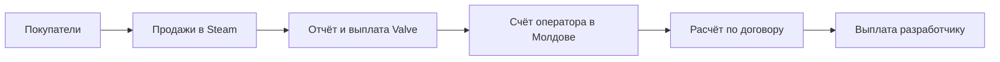

# про.стим паблишинг и расчёты

Оператор «про.стим» в Молдове сопровождает выпуск игры автора и получает доход от Valve как сторона издательских отношений. Затем он рассчитывает вознаграждение разработчика по договору. Автор финансирует разработку, а издатель оказывает согласованные услуги публикации и сопровождения.

## Регистрация и права

Valve допускает регистрацию физического лица или компании. Партнёр указывает действительное юридическое имя, проходит идентификацию и налоговую анкету. Имя владельца банковского счёта должно соответствовать партнёру Steamworks. Для публикации чужой игры оператору нужны права, предоставленные договором с автором. [Регистрация Steamworks](https://partner.steamgames.com/doc/gettingstarted/onboarding)

Для «про.стим» предлагается договор, по которому автор сохраняет права на игру и предоставляет издателю согласованную лицензию на распространение. Территория, срок, эксклюзивность, обновления и завершение сотрудничества определяются для каждого проекта.

Допустимость сотрудничества с конкретным разработчиком из РФ проверяется по сторонам договора, правам на игру, банкам и применимым ограничениям. Описанный Valve порядок учитывает ограничения по лицам, компаниям и территориям. Публичный FAQ не подтверждает общий тезис о запрете публикации для всех российских авторов. [Вопросы регистрации Steamworks](https://partner.steamgames.com/doc/gettingstarted/faq?language=english)

## От заявки до выпуска

1. **Заявка.** Автор передаёт описание игры, стадию готовности, демонстрацию, целевые платформы и сведения о правообладателе. Материалы заявки доступны автору и назначенному издателю.
2. **Оценка.** Издатель определяет готовность сборки и страницы магазина, необходимые работы и коммерческие условия. Автор получает перечень услуг и расходов.
3. **Договор.** Стороны фиксируют права, долю издателя 2% от выплаты Steam за игру, сроки отчётности и доступный способ выплаты.
4. **Подготовка.** Автор предоставляет сборку, графику, трейлер, описание, системные требования и сведения о содержимом. Издатель создаёт приложение и готовит страницу Steam.
5. **Проверки Valve.** Публикация проходит актуальные проверки страницы и сборки. Дата релиза учитывает проверку партнёра и обязательные сроки Steamworks.
6. **Релиз.** Стороны согласуют дату и публикуют игру после выполнения требований Valve.
7. **Сопровождение.** Издатель поддерживает отчётность и согласованные операции магазина, автор готовит обновления и исправления в пределах договора.
8. **Расчёт.** Выплата Valve соотносится с игрой, издатель удерживает 2%, из остатка вычитаются фактические банковские расходы и удержания, и деньги перечисляются автору.

Steam Direct предусматривает сбор 100 USD за приложение, с возможными местными косвенными налогами. Сбор компенсируется в выплате после достижения 1 000 USD Adjusted Gross Revenue. В договоре указывается плательщик сбора и получатель его компенсации. [Steam Direct Fee](https://partner.steamgames.com/doc/gettingstarted/appfee)

## Движение денег

Valve выплачивает доход ежемесячно, обычно до 30-го числа следующего месяца. Для партнёров вне США используется банковский перевод в USD через SWIFT. Минимальная сумма выплаты составляет 100 USD. Срок поступления дополнительно зависит от банков перевода. [Отчётность и выплаты Valve](https://partner.steamgames.com/doc/finance/payments_salesreporting), [Условия выплат](https://partner.steamgames.com/doc/finance/payments_salesreporting/faq?language=english)

Valve перечисляет деньги партнёру и не делит его выплату между несколькими банковскими счетами. Расчёты с отдельными авторами выполняет оператор «про.стим». Общий банковский перевод распределяется по играм на основании отчёта Valve с отражением фактических банковских расходов. [Вопросы выплат Valve](https://partner.steamgames.com/doc/finance/payments_salesreporting/faq?language=english)

## Доля издателя: 2%

Издатель получает 2% от суммы, которую Valve выплачивает за игру. Это деньги, которые уже прошли через Steam: из них вычтена доля Steam и удержания, которые Valve делает сама и показывает в отчёте (возвраты, налоги с покупателей, американское удержание по налоговой анкете).

2% удерживаются первыми, сразу после поступления выплаты Steam за игру. Банковские комиссии, конвертация валюты, налоговые удержания при выплате автору и перевод считаются после, из оставшихся 98%. Поэтому 2% не включают эти расходы и не зависят от них, а сумма на счёте автора будет меньше 98% на размер фактических комиссий и налогов.

Порядок расчёта по каждой игре за отчётный месяц:

1. Valve присылает отчёт и выплату. Общий перевод распределяется по играм по отчёту.
2. Из выплаты за игру удерживаются 2% издателя.
3. Остальные 98% относятся к автору. Из них по факту и с подтверждением вычитаются банковские комиссии за входящий и исходящий перевод, разница при конвертации валюты, налоговое удержание при выплате, если оно применимо, и платные услуги, которые автор заказал отдельно.
4. Остаток переводится автору. В кабинете видна каждая строка и подтверждение банка.

Других процентов издатель не берёт. Маркетинг, локализация, тестирование и другие дополнительные услуги оплачиваются только при отдельном согласии автора и отражаются отдельной строкой.

| Строка расчёта | Пример |
| --- | --- |
| Продажи игры в Steam за месяц | 1 000 USD |
| Доля Steam 30% | −300 USD |
| Выплата Valve за игру | 700 USD |
| 2% издателя, удерживаются первыми | −14 USD |
| Часть автора (98%) | 686 USD |
| Банковские комиссии, пример | −15 USD |
| Налоговое удержание при выплате | по закону и договору |
| К переводу автору | 671 USD до налогового удержания |

Суммы банковских комиссий и налогов в примере условные: они зависят от банков перевода, валюты и налогового статуса сторон. Если стороны согласуют резерв на последующие возвраты, его размер и срок освобождения фиксируются в договоре.

## Налоги

По результатам налоговой анкеты Valve определяет американское удержание в диапазоне 0–30% дохода из источников в США. Для игр применяется соответствующая ставка royalty copyright. Общая налоговая нагрузка зависит также от статуса оператора, получателя и договоров между ними. [Налоговые вопросы Steamworks](https://partner.steamgames.com/doc/finance/taxfaq)

Бухгалтер определяет налоговый режим оператора в Молдове, учёт дохода и расходов, возможное удержание при выплате автору и применимость международных соглашений. Автор получает документы для своего налогового учёта. Итоговая сумма рассчитывается после определения этих параметров.

## Канал выплаты разработчику

Банк оператора должен подтвердить возможность конкретного коммерческого платежа с выбранным назначением, получателем и банком зачисления. Например, условия maib для юридических лиц предусматривают подтверждающие документы и ограничения, затрагивающие стороны и банки перевода. Условия конкретного банка определяют доступный маршрут. [Условия maib для юридических лиц](https://www.maib.md/files/PJ/Conditii_generale_in_vigoare.pdf)

В исходной идее упомянуты PSN, «Золотая Корона» и поездка в Тирасполь для отправки через Сбербанк. PSN требует уточнения названия сервиса. Для каждого предложенного способа нужно установить оператора перевода, возможность издательских выплат от выбранного юридического лица, комиссии, лимиты, документы и условия банка получателя. Выбор способа происходит после получения этих данных.

Если проект дополнительно планирует принимать чужие средства для их перевода как самостоятельную услугу, применимость регулирования платёжных организаций определяется отдельно по фактической модели. [Регулирование платёжных организаций НБМ](https://www.bnm.md/ro/content/regulamentul-cu-privire-la-licentierea-si-inregistrarea-societatilor-de-plata-societatilor)

## Содержание договора и кабинета

В договоре фиксируются правообладатель, игра, лицензия, услуги издателя, доля издателя 2% от выплаты Steam за игру и порядок её удержания, оплата Steam Direct, дополнительные расходы, отчётные периоды, сроки выплат и валютные правила. Также согласуются обновления, согласование скидок, поддержка игроков, прекращение сотрудничества и судьба приложения в Steam.

В кабинете автор видит договор, этапы заявки, отчёт по каждой игре, начисленную долю и статус выплаты. Финансовая запись сохраняет отчётный период и подтверждающие документы. Изменения проведённого расчёта оформляются отдельной корректировкой с историей.

Повтор отправки платежа начинается после выяснения результата предыдущей попытки. Статус выплаты обновляется по подтверждению банка. При задержке или возврате перевода автор видит причину и следующий доступный шаг.
