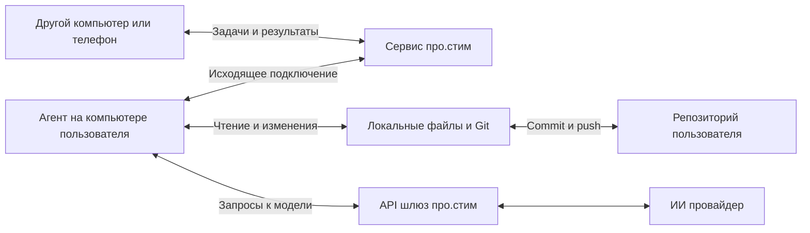

# про.стим удалённая работа с проектами

Пользователь подключает свой рабочий компьютер к «про.стим» и управляет проектом из браузера другого компьютера или телефона. Исходники, Git-репозиторий и история рабочих задач сохраняются на подключённом компьютере. Сервис связывает устройства, доставляет команды и предоставляет выбранный способ доступа к ИИ.

## Основная схема

Предлагаемая архитектура использует локальное приложение, далее называемое агентом устройства. Оно выполняет операции с файлами, Git и командами на рабочем компьютере пользователя. Цикл работы ИИ также ведётся агентом устройства, который запрашивает модель и выполняет разрешённые вызовы инструментов.

Модель обрабатывает контекст через API, а файлы и команды обслуживает компьютер пользователя. Вызов инструмента из ответа модели возвращается агенту устройства. Агент проверяет полномочия, выполняет действие и отправляет результат в следующий запрос к модели.

Обычная веб-страница может работать с выбранной папкой в поддерживающих браузерах через File System Access API. Для доступа к проекту на другом компьютере и устойчивого выполнения системных команд используется установленное приложение с соответствующими правами ОС. [Выбор папки в браузере](https://developer.mozilla.org/en-US/docs/Web/API/Window/showDirectoryPicker)

## Первое подключение

1. Пользователь создаёт аккаунт «про.стим» и устанавливает агент на компьютер с проектом.
2. Агент инициирует привязку устройства. Пользователь подтверждает показанное устройство в своём аккаунте, после чего оно получает собственные учётные данные.
3. Пользователь выбирает локальную папку проекта и название, отображаемое на сайте. Путь к папке сопоставляется с идентификатором проекта на самом устройстве.
4. Пользователь задаёт доступные действия с проектом, включая чтение, редактирование, команды и операции Git.
5. Агент открывает исходящее защищённое соединение с сервисом и сообщает состояние подключения.
6. С другого компьютера или телефона пользователь входит в аккаунт, выбирает устройство и открывает рабочую сессию.

Для пилота предлагается постоянное исходящее WSS-соединение агента с сервером. Браузер также подключается к серверу. Такая схема позволяет доставлять команды через существующее интернет-соединение устройства. Переподключение проверяет принадлежность устройства и восстанавливает доступную сессию.

## Рабочая задача

Пользователь открывает проект и пишет, например, «Добавь поиск в каталоге и покажи изменения». Сервис доставляет запрос выбранному устройству. Агент формирует контекст из нужных файлов, отправляет запрос к модели, применяет разрешённые изменения и запускает доступные проверки.

В браузере отображаются состояние задачи, сообщения, вывод команд и diff. Агент сохраняет полную историю локально и передаёт её открытой пользовательской сессии. Настройки сессии определяют, какие операции выполняются автоматически и какие ожидают подтверждения.

Управление доступно с компьютера и телефона. Рабочий компьютер должен быть включён, агент запущен, а сеть доступна. При недоступном устройстве интерфейс показывает причину и предлагает повторить подключение. Постановка новых задач в облачную очередь с содержимым запросов требует отдельного выбора способа хранения.

Закрытие браузера сохраняет задачу на рабочем устройстве в пределах выданных полномочий. При следующем подключении агент возвращает актуальное состояние. Отмена считается выполненной после подтверждения агентом и завершения соответствующих процессов.

## Размещение данных

| Данные | Предлагаемое место хранения |
| --- | --- |
| Исходники, локальная база задач, diff и вывод команд | Компьютер пользователя |
| История Git и опубликованные пользователем изменения | Локальный Git и выбранный репозиторий пользователя |
| Профиль, устройства, роли, состояние задач и расходы | Backend «про.стим» |
| Публичные карточки, трейлеры, комментарии и обсуждения | Хранилище платформы |
| Контекст модели и результаты инструментов | Временная обработка API-шлюзом и провайдером |
| Документы издательской заявки | Хранилище платформы с доступом участников заявки |

При оплате через API оператора сервер получает содержимое модельного запроса во время обработки. Сохранение проекта у пользователя совместимо с передачей выбранных фрагментов провайдеру. Пользователь должен видеть этот маршрут при подключении интеграции.

Предлагаемый режим хранения рабочих данных оставляет содержимое запросов и ответы в памяти шлюза на время передачи. Журналы сервера записывают идентификаторы, статусы, объём использования и ошибки без рабочих текстов. Содержимое исключается из трассировок, постоянных очередей и резервных копий. Правила хранения у ИИ-провайдера описываются для выбранной интеграции.

Автор отдельно выбирает, какие скриншоты, описания или результаты опубликовать в ленте. Публичная карточка и рабочая папка связаны идентификатором проекта. Приватность рабочей папки сохраняет собственные настройки независимо от видимости карточки.

## Два варианта оплаты ИИ

**Через оператора.** Агент обращается к API-шлюзу «про.стим», шлюз использует API-организацию оператора, а сервис учитывает расход пользователя. Пользователь оплачивает согласованный тариф с пределом расходов.

**Через пользователя.** Пользователь подключает свою API-организацию либо поддерживаемую официальную интеграцию собственного аккаунта. Вариант с личным API-ключом позволяет хранить его на устройстве и обращаться к провайдеру оттуда. Маршрутизация через шлюз платформы также возможна по выбранной схеме подключения и обработки ключей.

Если используется официальный локальный клиент провайдера с подписочным входом, учётные данные и ограничения принадлежат конкретному пользователю. Возможность включения такого клиента в продукт и автоматизации определяется условиями соответствующего клиента. Подробности приведены в [ИИ сервисе](ai-service.md).

При прямом пользовательском вызове модели через платформу проходят команды управления и состояние сессии. При маршрутизации модели через шлюз дополнительно передаются её запросы и ответы. Интерфейс показывает выбранный маршрут и плательщика.

## Git и GitHub

Основной сценарий использует локальный Git и существующий remote пользователя. Агент может создавать ветку задачи, показывать diff, выполнять проверки и готовить commit. Push и создание pull request выполняются в пределах выбранных полномочий. Учётные данные Git остаются в пользовательской среде.

Перед записью агент проверяет исходную версию файла. Изменения, сделанные пользователем в редакторе во время задачи, учитываются при применении diff. При конфликте задача возвращает актуальные материалы для согласования. Для независимых задач можно использовать локальные Git worktree с выбранной исходной версией.

GitHub App добавляет подключение выбранных репозиториев, статусы, pull request и уведомления. Пользователь определяет репозитории и разрешения приложения. Владельцем репозитория остаётся пользователь или его организация. [Возможности GitHub Apps](https://docs.github.com/en/apps/creating-github-apps/about-creating-github-apps/about-creating-github-apps)

Webhook сообщает сервису о событии, например новом commit или изменении pull request. Выполнение команды в локальном проекте требует связи с агентом. Для работы при выключенном компьютере можно подключить исполнительную среду в облачном аккаунте пользователя и определить хранение её рабочей копии.

### Работа прямо с репозиторием

Дополнительный режим использует выбранный репозиторий пользователя как источник проекта. Через разрешения GitHub App сервис читает нужные файлы, формирует изменения в отдельной ветке и открывает pull request. Содержимое обрабатывается временно, а результат сохраняется в репозитории пользователя. Для выполнения сборки и тестов подключаются его CI или облачная среда.

Этот режим доступен из браузера при выключенном локальном компьютере. Локальный checkout получает принятые изменения обычными операциями Git после подключения компьютера. Незакоммиченные локальные файлы используются в режиме работы через агент устройства. Настройка доступа и событий выполняется в пределах выбранных репозиториев и разрешений. [Разрешения GitHub App](https://docs.github.com/en/apps/creating-github-apps/registering-a-github-app/choosing-permissions-for-a-github-app)

## Роль MCP

MCP позволяет подключать к ИИ-приложению инструменты чтения файлов, Git и других сервисов. Стандартные способы подключения включают stdio для локальных процессов и Streamable HTTP для сетевых серверов. В предлагаемой схеме агент использует MCP-клиент для доступных инструментов, а канал WSS обслуживает привязку устройств и доставку удалённых задач как протокол самой платформы. [Архитектура MCP](https://modelcontextprotocol.io/docs/learn/architecture)

Для первого пилота достаточно реализовать нужные инструменты агента и канал управления. Совместимость с внешними MCP-серверами добавляется для выбранных интеграций с проверкой полномочий каждой операции.

## Полный рабочий стол

Дополнительный режим предоставляет изображение рабочего стола и управление мышью и клавиатурой. Агент захватывает экран с разрешениями ОС, браузер отображает поток и отправляет команды ввода. Пользователь выбирает устройство, разрешённый режим сессии и может завершить доступ.

Для передачи экрана и данных подходят WebRTC и data channel. Сервис выполняет сигнализацию соединения. TURN обеспечивает ретрансляцию при недоступности прямой связи и учитывается в стоимости трафика. Реализация ввода и разрешений зависит от ОС рабочего компьютера. [WebRTC](https://developer.mozilla.org/en-US/docs/Web/API/WebRTC_API), [TURN](https://webrtc.org/getting-started/turn-server)

AnyDesk можно рассматривать как отдельную интеграцию для согласованного режима удалённого рабочего стола. Возможности встраивания и коммерческие условия проверяются перед выбором поставщика.

## Полномочия и восстановление

Доступ назначается для пользователя, устройства и проекта. Владелец может отозвать сессию с сайта или остановить агент локально. При удалённой совместной работе второй участник получает отдельную роль и набор действий.

Файловые инструменты проверяют канонические пути и разрешённые операции, включая ссылки на другие каталоги. Системные команды выполняются с правами процесса агента. Если требуется жёсткая изоляция команд, используется подходящий механизм ОС или песочница. Рабочий каталог команды задаёт место запуска и сам по себе не ограничивает системные права.

Каждая изменяющая операция получает идентификатор и запись в локальном журнале. Повтор доставки возвращает известный результат. Для операции с неопределённым исходом агент сначала устанавливает фактическое состояние. Одновременные изменения одной рабочей папки координируются на устройстве, а внешние изменения проверяются по версии файла.

## Технический пилот

Первый пилот проверяет одну выбранную ОС, локальную папку, управление из браузера другого компьютера и один способ доступа к API. Рабочий сценарий включает привязку устройства, чтение проекта, задачу ИИ, применение diff, выполнение проверки и подготовку изменения в Git.

Затем проверяются подключение телефона, потеря связи, повтор команды, отмена и восстановление сессии. В пользовательском интерфейсе показываются место выполнения задачи, состояние устройства, маршрут данных и стоимость. Полный рабочий стол и облачная среда пользователя оцениваются отдельными этапами.

## Реализация пилота

Первая версия схемы работает в `site/`. Агент — один файл `agent/prostim-agent.mjs` без зависимостей, сайт отдаёт его по адресу `/agent.mjs`. Привязка идёт по одноразовому коду из раздела «ИИ-мир → Подключить», после неё агент хранит собственный токен устройства в `~/.prostim/agent.json`. Вместо WSS пилот использует SSE от сервера к агенту и обычные HTTPS-запросы в обратную сторону: так не нужны дополнительные библиотеки, а соединение проходит через прокси хостинга.

Агент запускает официальные клиенты: Claude Code в режиме `-p --output-format stream-json` и Codex в режиме `exec --json`. События клиента переводятся в шаги сайта: размышления, текст, чтение файла, правка с diff, создание файла, команда с выводом, план, итог, стоимость и запрещённые в выбранном режиме действия. Продолжение диалога использует идентификатор сессии клиента.

### Большие проекты и только Git

Сервер не копирует проект. Поэтому размер папки не важен: агент работает с ней на месте, а на сервер уходят только шаги задачи и открытые пользователем файлы. Если у пользователя есть только репозиторий и выключен компьютер, проект открывается в исполнительной среде пользователя — облачной машине, Codespace или CI — с тем же агентом. Такая среда клонирует одну ветку без истории (`git clone --depth 1 --branch <ветка>`) и при необходимости только нужные каталоги (`--filter=blob:none --sparse`). Результат возвращается коммитом в отдельную ветку и pull request. Хранить полную копию репозитория на стороне про.стим для этого не требуется.
